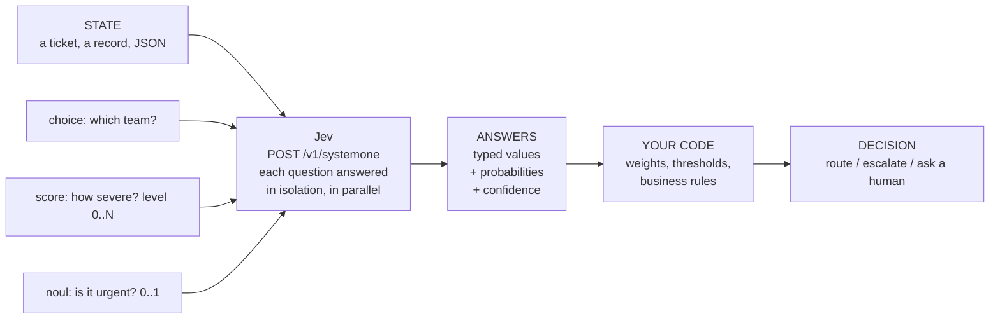

# jev-ai-demo

A small, runnable demo of how **[Jev](https://docs.typesafe.ai/introduction)** works. Jev is TypeSafe's "System One" model, also served as the [Jev API](https://www.jevai.org/docs).

> Unofficial community demo. Not affiliated with TypeSafe.

## The idea in 30 seconds

A normal LLM call sends a prompt and gets text back, which you then parse.

Jev does something different. You send a **state** (your data) plus a set of **typed questions** about it. You get back **typed answers with calibrated probabilities**, ready to use in code. Jev never writes the decision for you. It gives you the facts, and your code makes the decision.



There are three question types, called **primitives**:

| Primitive | Asks | You get back | Example |
|---|---|---|---|
| `choice` | Pick one option from a list | `choice`, `probabilities`, `confidence` | "Which team?" gives `technical` (1.00) |
| `score` | Which level on an ordered scale? | `score` (expected level), `probabilities`, `confidence` | "How severe? 0-2" gives `1.24`, mostly level 1 with some level 2 |
| `noul` | Is this statement true? | `noul`, a probability from 0 to 1 | "Is it urgent?" gives `0.99` |

**Confidence** tells you how sure Jev is. It's the most useful number in the response, because it tells your code when to act automatically and when to hand off to a person.

---

## Part 1: Walk through the examples (no API key needed)

```bash
git clone https://github.com/georgeykalangi/jev-ai-demo.git
cd jev-ai-demo
python3 -m venv .venv && .venv/bin/pip install -e ".[dev]"

.venv/bin/python examples/01_quickstart.py
.venv/bin/python examples/02_atomic_scoring.py
.venv/bin/python examples/03_confidence_routing.py
```

Without a key, each example **replays a recorded response**: the sample answers published in the TypeSafe docs (each file in `fixtures/` links to its source page). Every example prints the same five steps:

```
[1] The STATE      what Jev looks at
[2] The QUESTIONS  what you ask about it
[3] The ANSWERS    what Jev returns, with probability bars
[4] YOUR CODE      which rule fired, and why
    -> the final DECISION
```

### Example 1: Quickstart, all three primitives in one request

**Input:** *"Our API integration started returning 500 errors on every request about 20 minutes ago, and we can't process any customer orders..."*

**Questions:** which team (`choice`), how frustrated (`score` 0-2), and whether it's urgent (`noul`).

```
[4] Jev's ANSWERS
    department: choice = technical   confidence 1.00
        technical                          #################### 1.00
        billing                            .................... 0.00
    frustration: score = 0.67 (expected level)   confidence 0.50
        1: Frustrated but civil            #############....... 0.67
        0: Calm, just stating facts        #######............. 0.33
    is_urgent: noul = 0.99
        true                               #################### 0.99

[5] YOUR CODE decides
    - department is technical and urgency 0.99 > 0.9
    ACTION: page_on_call_engineer
```

**What it shows:** there's no text to parse. `answers["is_urgent"]["noul"]` is a number you can put straight into an `if` statement.

### Example 2: Atomic scoring, three narrow questions combined in code

**Input:** a bug report about PDF export failing, from an annoyed customer who included steps to reproduce.

**Instead of** asking "what priority is this?", which is vague and can't be tuned, it asks three narrow `score` questions: severity, frustration and report quality. Python then combines them:

```
[4] YOUR CODE combines them
    severity        1.24 / 2 = 0.62  x weight 0.6  = 0.372
    frustration     1.28 / 2 = 0.64  x weight 0.3  = 0.192
    report_quality  3.00 / 3 = 1.00  x weight 0.1  = 0.100
                                               total = 0.664
    PRIORITY: P2
```

**What it shows:** if your business wants frustrated customers to count more, you change `FRUSTRATION_WEIGHT` in [`jev_demo/triage.py`](jev_demo/triage.py). You don't touch a prompt, and the change is easy to review and test.

### Example 3: Confidence-aware routing, acting on uncertainty

**Input:** *"Shoes arrived two weeks late and in the wrong size. Also I see two charges of $120 on my card..."* This message mixes three problems.

```
[3] Jev's ANSWERS
    department: choice = returns   confidence 0.42      <- not sure
        returns                            ############........ 0.61
        billing                            #######............. 0.35   <- billing is involved too
    requested_resolution: choice = refund   confidence 0.20   <- customer never said
        refund                             ########............ 0.40
        replacement                        #######............. 0.34

[4] YOUR CODE decides
    - department confidence 0.42 >= 0.3: auto-route to returns
    - billing has probability 0.35 > 0.25: CC them
    - requested_resolution confidence 0.20 < 0.5: ask, don't guess
    ROUTE TO: returns  (issue: wrong_size)
    CC:       billing
    ACTIONS:  ask_customer_what_they_want
```

**What it shows:** a plain LLM would just say "returns". Jev's probabilities show that billing is also involved, and its low confidence shows the customer never said what they want. Your code can act on both.

---

## Part 2: Live demo with the real model

The only thing you need is a TypeSafe API key. Nothing else is required (no Vercel, no OpenAI and no extra packages).

**1. Get a key** at [console.typesafe.ai/keys](https://console.typesafe.ai/keys).

**2. Put it in `.env`.** This file is git-ignored, so the key never gets committed.

```bash
cp .env.example .env
# edit .env so it reads:  TYPESAFE_API_KEY=your-key
```

**3. Run any example.** The header switches to LIVE:

```bash
.venv/bin/python examples/01_quickstart.py
# mode: LIVE: calling api.typesafe.ai
```

Live answers may differ slightly from the recorded ones, since the model version can change. The structure is the same.

**4. Try your own message.** Example 4 only works live:

```bash
.venv/bin/python examples/04_try_your_own.py "I was charged twice this month and nobody answers my emails!!"
.venv/bin/python examples/04_try_your_own.py "Hi, do you offer discounts for nonprofits?"
.venv/bin/python examples/04_try_your_own.py "Production is down, every checkout fails with a 502"
```

Each run asks the same three questions as Example 1, about whatever you typed, and prints Jev's answers along with the action your code would take. You would expect the second message to be queued for sales and the third to page the on-call engineer. Try it and see what the model says.

Common errors:

| You see | Meaning |
|---|---|
| `mode: OFFLINE` | No key was found. Check that `.env` has `TYPESAFE_API_KEY=...` with no spaces around `=`. |
| `Jev API returned 401` | The key is wrong or revoked. TypeSafe keys come from console.typesafe.ai, and keys from other services (for example Vercel `vck_...`) won't work. |
| `Could not reach Jev API` | Network problem. Check your connection. |

---

## What's on the wire

The client is about 90 lines of standard-library Python ([`jev_demo/client.py`](jev_demo/client.py)), so you can see the whole protocol:

```http
POST https://api.typesafe.ai/v1/systemone
Authorization: Bearer $TYPESAFE_API_KEY
Content-Type: application/json

{
  "model": "jev-latest",
  "state": "My running shoes arrived in the wrong size...",
  "questions": {
    "department": {
      "type": "choice",
      "instructions": "Which team should handle this?",
      "criteria": {"returns": "Exchanges...", "shipping": "Delivery...", "billing": "Charges..."}
    }
  }
}
```

```json
{
  "model": "jev-1.13.0",
  "answers": {
    "department": {
      "type": "choice", "choice": "returns", "confidence": 1.0,
      "probabilities": {"returns": 1.0, "shipping": 0.0, "billing": 0.0}
    }
  },
  "usage": {"input_tokens": 328, "output_tokens": 34}
}
```

For production use, prefer the official SDKs: `pip install typesafe-sdk` or `npm install @typesafe-ai/sdk`.

## Layout

```
jev_demo/
  questions.py   choice() / score() / noul() -> request JSON
  client.py      ask(): one POST (live), or replay a fixture (offline)
  triage.py      YOUR CODE: questions, weights, thresholds, routing rules
examples/        01-03 work offline; 04 is live only
fixtures/        recorded responses from the TypeSafe docs
tests/           pytest, always offline (`.venv/bin/python -m pytest`)
```

## Links

- TypeSafe docs: https://docs.typesafe.ai/introduction
- Jev API docs (presets such as tool-guard, model-route and completion checks, plus MCP): https://www.jevai.org/docs

## License

MIT
