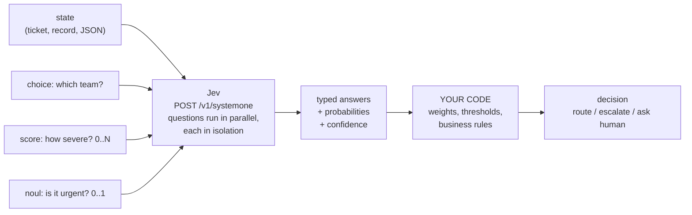

# jev-ai-demo

A small, runnable demo of how **[Jev](https://docs.typesafe.ai/introduction)** works. Jev is TypeSafe's "System One" model, also served as the [Jev API](https://www.jevai.org/docs).

> Unofficial community demo. Not affiliated with TypeSafe.

## The idea in 30 seconds

A normal LLM call sends a prompt and gets text back, which you then parse.
Jev does something different. You send a **state** (your data) plus a set of **typed questions** about it. You get back **typed answers with calibrated probabilities**, ready to use in code.



Three question types, called **primitives**:

| Primitive | Asks | Returns |
|---|---|---|
| `choice` | Pick one option from a list | `choice`, `probabilities`, `confidence` |
| `score` | Where on an ordered scale (level 0..N)? | `score` (expected level, e.g. `1.24`), `probabilities`, `confidence`, `legend` |
| `noul` | Is this statement true? | `noul`, a probability from 0 to 1 |

The design rule that matters: **ask atomic questions, decide in code.** For example, don't ask "what priority is this bug?" Ask about severity, frustration and report quality as separate questions, then weight them in Python. Changing a business rule then means editing a constant, not rewriting a prompt.

## Run it (no API key needed)

```bash
git clone https://github.com/georgeykalangi/jev-ai-demo.git
cd jev-ai-demo
python3 -m venv .venv && .venv/bin/pip install -e ".[dev]"

.venv/bin/python examples/01_quickstart.py
.venv/bin/python examples/02_atomic_scoring.py
.venv/bin/python examples/03_confidence_routing.py
.venv/bin/python -m pytest
```

Without a key, each example **replays a recorded response** from `fixtures/`. These are the sample responses published in the TypeSafe docs, and each fixture links to its source page.

To call the real model, get a key at [console.typesafe.ai/keys](https://console.typesafe.ai/keys) and run:

```bash
export TYPESAFE_API_KEY="your-key"
.venv/bin/python examples/01_quickstart.py   # prints "mode: LIVE"
```

## The examples

| # | Shows | Key takeaway |
|---|---|---|
| [01_quickstart](examples/01_quickstart.py) | `choice` + `score` + `noul` in one request | Answers are typed values. Nothing to parse. |
| [02_atomic_scoring](examples/02_atomic_scoring.py) | 3 `score` questions combined into one priority | Weights live in code (`jev_demo/triage.py`), not in a prompt. |
| [03_confidence_routing](examples/03_confidence_routing.py) | An ambiguous ticket (late delivery, wrong size and a double charge) | Use `confidence` and `probabilities`: route to returns, CC billing, and ask the customer when unsure. |

Output of example 3:

```
<-- answers
  department             choice  -> returns  (confidence 0.42)
  return_reason          choice  -> wrong_size  (confidence 1.00)
  requested_resolution   choice  -> refund  (confidence 0.20)
  ...
department probabilities: {'shipping': 0.04, 'billing': 0.35, 'returns': 0.61}
decision: RoutingDecision(team='returns', issue='wrong_size', cc_teams=['billing'],
                          actions=['ask_customer_what_they_want'])
```

An LLM returning just "returns" would hide that billing is also involved and that the customer never said what they want. The probabilities show both.

## What's on the wire

The client is about 75 lines of standard-library Python ([`jev_demo/client.py`](jev_demo/client.py)), so you can see the whole protocol:

```http
POST https://api.typesafe.ai/v1/systemone
Authorization: Bearer $TYPESAFE_API_KEY
Content-Type: application/json

{
  "model": "jev-latest",
  "state": "My running shoes arrived in the wrong size...",
  "questions": {
    "department": {
      "type": "choice",
      "instructions": "Which team should handle this?",
      "criteria": {"returns": "Exchanges...", "shipping": "Delivery...", "billing": "Charges..."}
    }
  }
}
```

```json
{
  "model": "jev-1.13.0",
  "answers": {
    "department": {
      "type": "choice", "choice": "returns", "confidence": 1.0,
      "probabilities": {"returns": 1.0, "shipping": 0.0, "billing": 0.0}
    }
  },
  "usage": {"input_tokens": 328, "output_tokens": 34}
}
```

For production use, prefer the official SDKs: `pip install typesafe-sdk` or `npm install @typesafe-ai/sdk`.

## Layout

```
jev_demo/
  questions.py   choice() / score() / noul() -> request JSON
  client.py      ask(): one POST, or replay a fixture offline
  triage.py      the business logic: weights, thresholds, routing
examples/        three runnable walkthroughs
fixtures/        recorded responses from the TypeSafe docs
tests/           pytest, runs fully offline
```

## Links

- TypeSafe docs: https://docs.typesafe.ai/introduction
- Jev API docs (presets such as tool-guard, model-route and completion checks, plus MCP): https://www.jevai.org/docs

## License

MIT
